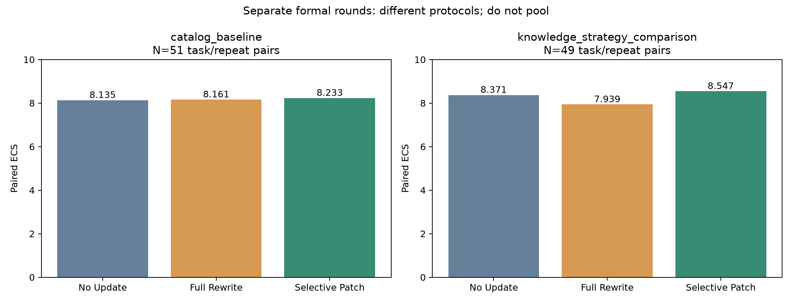
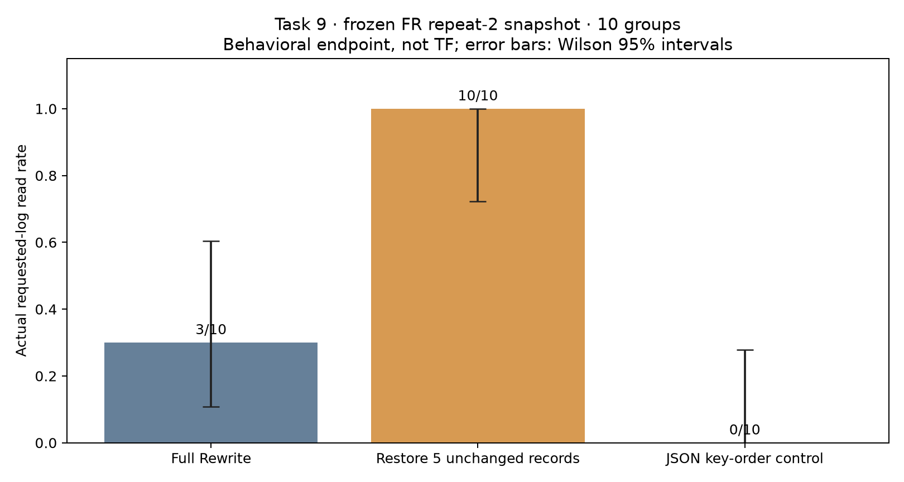

# Final indexed Role 4 analysis / 最终索引分析

Source of truth: `results/index.json`. Two formal rounds and one supplemental behavioral case are reported separately. / 两轮正式实验与补充行为案例独立报告，不合并均分。

## catalog_baseline

Run: `results/20261019T234451.269257Z_Kevin`; protocol `shared_early_json_v1`; backend `legacy`; dirty_source=False.

Logical trajectories 459; unique executions 357; scored executions 357; shared Early aliases 102; matched all-stage ECS pairs 51.

| Strategy | Stage | Matched N | TF | TF repeat SD | PE | PE repeat SD | Paired ECS |
| --- | --- | --- | --- | --- | --- | --- | --- |
| no_update | original | 51 | 8.9529 | 0.0888 | 9.7137 | 0.1902 | 8.1351 |
| no_update | iter3 | 51 | 8.6745 | 0.3849 | 9.5922 | 0.3540 | 8.1351 |
| no_update | iter5 | 51 | 8.7255 | 0.3800 | 9.5778 | 0.3197 | 8.1351 |
| full_rewrite | original | 51 | 8.9529 | 0.0888 | 9.7137 | 0.1902 | 8.1613 |
| full_rewrite | iter3 | 51 | 8.8275 | 0.1567 | 9.9098 | 0.0783 | 8.1613 |
| full_rewrite | iter5 | 51 | 8.5922 | 0.4650 | 9.8706 | 0.2241 | 8.1613 |
| selective_patch | original | 51 | 8.9529 | 0.0888 | 9.7137 | 0.1902 | 8.2332 |
| selective_patch | iter3 | 51 | 9.0314 | 0.5718 | 9.9176 | 0.1326 | 8.2332 |
| selective_patch | iter5 | 51 | 8.7422 | 0.1362 | 9.9804 | 0.0180 | 8.2332 |

SD describes three repeat-level means, not five judge slots. ECS uses population SD across versions; the same task/repeat pairs are used for all strategies. / 标准差按执行重复；ECS版本间用总体标准差。

| Strategy | Stage | Cohort | Matched N | ΔTF vs No Update |
| --- | --- | --- | --- | --- |
| full_rewrite | iter3 | changed | 12 | 1.1167 |
| full_rewrite | iter3 | retention | 39 | -0.1436 |
| full_rewrite | iter5 | changed | 12 | 0.9333 |
| full_rewrite | iter5 | retention | 39 | -0.4615 |
| selective_patch | iter3 | changed | 12 | 1.5667 |
| selective_patch | iter3 | retention | 39 | -0.0154 |
| selective_patch | iter5 | changed | 12 | 1.0167 |
| selective_patch | iter5 | retention | 39 | -0.2910 |

| Strategy | Updates | Calls | Input tokens | Output tokens | Update seconds | Reported USD |
| --- | --- | --- | --- | --- | --- | --- |
| no_update | 6 | 0 | 0 | 0 | 0.0051 | 0 |
| full_rewrite | 6 | 0 | 0 | 0 | 0.0056 | 0 |
| selective_patch | 6 | 0 | 0 | 0 | 0.0191 | 0 |

Costs are sums over six version transitions, not per-task costs or whole-experiment spending. / 费用为六次更新合计，不是单任务或全实验总费用。

| Strategy | Role | Usage records | Input tokens | Output tokens |
| --- | --- | --- | --- | --- |
| no_update | agent | 389 | 3433604 | 101401 |
| no_update | judge | 765 | 7785405 | 123364 |
| full_rewrite | agent | 249 | 2261452 | 67509 |
| full_rewrite | judge | 510 | 5221475 | 81480 |
| selective_patch | agent | 275 | 2541225 | 66356 |
| selective_patch | judge | 508 | 5236519 | 81452 |

Agent/Judge usage is counted physically, with shared Early charged once to its No Update owner. These asymmetric totals are accounting records, not normalized per-method runtime estimates. USD is unavailable rather than inferred as zero. / 共享Early只计一次；token记录不等于完整美元账单。

Coverage: `{'completed': 357}`; judge slots: `{'completed': 1769, 'failed': 14, 'outcome_unknown': 2}`. Exclusions and checksums are retained in analysis.json.

## knowledge_strategy_comparison

Run: `results/20261026T084527.010290Z_Kevin`; protocol `experience_evolution_v1`; backend `langchain`; dirty_source=True.

Logical trajectories 459; unique executions 357; scored executions 355; shared Early aliases 102; matched all-stage ECS pairs 49.

| Strategy | Stage | Matched N | TF | TF repeat SD | PE | PE repeat SD | Paired ECS |
| --- | --- | --- | --- | --- | --- | --- | --- |
| no_update | original | 51 | 9.6118 | 0.2362 | 9.9843 | 0.0272 | 8.3708 |
| no_update | iter3 | 51 | 8.5304 | 0.1292 | 9.4441 | 0.3408 | 8.3708 |
| no_update | iter5 | 49 | 8.7755 | 0.6372 | 9.7963 | 0.1429 | 8.3708 |
| full_rewrite | original | 51 | 9.6118 | 0.2362 | 9.9843 | 0.0272 | 7.9391 |
| full_rewrite | iter3 | 51 | 9.0549 | 0.2513 | 9.9020 | 0.1028 | 7.9391 |
| full_rewrite | iter5 | 49 | 8.2020 | 0.8811 | 9.5048 | 0.5141 | 7.9391 |
| selective_patch | original | 51 | 9.6118 | 0.2362 | 9.9843 | 0.0272 | 8.5471 |
| selective_patch | iter3 | 51 | 9.1608 | 0.3201 | 10.0000 | 0.0000 | 8.5471 |
| selective_patch | iter5 | 49 | 8.7837 | 0.2239 | 9.7361 | 0.2775 | 8.5471 |

SD describes three repeat-level means, not five judge slots. ECS uses population SD across versions; the same task/repeat pairs are used for all strategies. / 标准差按执行重复；ECS版本间用总体标准差。

| Strategy | Stage | Cohort | Matched N | ΔTF vs No Update |
| --- | --- | --- | --- | --- |
| full_rewrite | iter3 | changed | 12 | 2.1708 |
| full_rewrite | iter3 | retention | 39 | 0.0179 |
| full_rewrite | iter5 | changed | 11 | 1.6182 |
| full_rewrite | iter5 | retention | 38 | -1.2079 |
| selective_patch | iter3 | changed | 12 | 1.5208 |
| selective_patch | iter3 | retention | 39 | 0.3564 |
| selective_patch | iter5 | changed | 11 | 0.9636 |
| selective_patch | iter5 | retention | 38 | -0.2684 |

| Strategy | Updates | Calls | Input tokens | Output tokens | Update seconds | Reported USD |
| --- | --- | --- | --- | --- | --- | --- |
| no_update | 6 | 0 | 0 | 0 | 0.0153 | 0 |
| full_rewrite | 6 | 42 | 132853 | 14955 | 229.4268 | 0.0182 |
| selective_patch | 6 | 12 | 30041 | 3944 | 76.2601 | 0.0042 |

Costs are sums over six version transitions, not per-task costs or whole-experiment spending. / 费用为六次更新合计，不是单任务或全实验总费用。

| Strategy | Role | Usage records | Input tokens | Output tokens |
| --- | --- | --- | --- | --- |
| no_update | agent | 350 | 4438622 | 86041 |
| no_update | judge | 765 | 7710550 | 121981 |
| full_rewrite | agent | 245 | 3253872 | 62600 |
| full_rewrite | judge | 505 | 5194120 | 80517 |
| selective_patch | agent | 233 | 3043918 | 53621 |
| selective_patch | judge | 505 | 5126080 | 81614 |

Agent/Judge usage is counted physically, with shared Early charged once to its No Update owner. These asymmetric totals are accounting records, not normalized per-method runtime estimates. USD is unavailable rather than inferred as zero. / 共享Early只计一次；token记录不等于完整美元账单。

Coverage: `{'completed': 355, 'execution_failed': 2}`; judge slots: `{'completed': 1737, 'failed': 38, 'not_attempted': 10}`. Exclusions and checksums are retained in analysis.json.

## Why rounds are not pooled / 为什么不能合并

Both rounds use the original 17 tasks, three stages, three Agent repeats and five judge slots, with Agent temperature 0.2 and judge temperature 0. Round 1 is catalog-only/legacy Agent and deterministic updates; Round 2 uses LangChain and strategy-owned learned experience with a common paid updater. Therefore the rounds are different system conditions, not six repetitions of one condition. Cross-round differences cannot be attributed only to Selective Patch.

第一轮只更新工具目录，三策略均无更新模型费用；第二轮加入LangChain与自维护经验，两种更新策略使用同一更新模型与校验规则。以前“Full Rewrite零更新费用”的说法仅适用于第一轮。

## Task 9: separate behavioral endpoint / 独立的行为消融

| Condition | Actual log reads | Rate | Wilson 95% interval | Plan created (secondary) |
| --- | --- | --- | --- | --- |
| fr_all | 3/10 | 0.3000 | [0.1078, 0.6032] | 3 |
| fr_changed_only | 10/10 | 1.0000 | [0.7225, 1] | 10 |
| fr_order_only | 0/10 | 0.0000 | [0, 0.2775] | 0 |

Paired primary comparison: 7 restoration-only successes, 0 FR-only successes; descriptive exact two-sided paired p=0.015625. No multiplicity or exploratory-screening correction is implied.

No Judge calls were made: these numbers are not TF or full task-completion scores. Successful read means the actual requested log contents were returned by read_text_file. Request-planning creation is a separate secondary observable and does not by itself certify all user goals.

All callable tools, two affected experience records, user input, non-memory system input, model/decoding and initial workspace contents are fixed within groups. Five original-K0 records for unavailable, unchanged tools are restored in fr_changed_only. fr_order_only only changes JSON object-key presentation of all FR records, including affected ones; list order and semantic values are unchanged.

结论：固定任务9和这份Full Rewrite快照下，恢复五条未变化经验带来更高的实际读取成功率，支持全库注入时不必要重写可能通过上下文干扰损害行为。不能指认某句知识被删，也不能推广为所有任务都更好。

## Limitations and provenance / 限制与来源

- Task 9 and the FR repeat-2 snapshot were selected after exploratory screening. The ten-group confirmation was fixed before dispatch, but is not an independent random benchmark sample. Retain this disclosure in slides and reports.
- Restoration changes wording, length and presentation together. Order-only outcomes demonstrate sensitivity; they do not isolate the harmful sentence or prove a single semantic mechanism.
- Ten fresh private workspace groups reset state between conditions; do not describe this as thirty independent tasks. Three arms share each group’s initial inputs and provider account.
- Round 2 and the supplemental case record dirty_source=true. The archived source hashes are verified; traceability is not equivalent to satisfying the older clean-source requirement.
- Formal main scores are not rewritten by this supplemental case. Task-403 preparation is superseded for the final case, not represented as a successful experiment.
- Source-record bytes differ only by Git newline normalization. The semantic source hash was independently matched to the published review; use recorded checksums rather than silently ignoring a byte mismatch.
- Original formal results use a limited, gate-selected task set. No universal model/harness improvement or statistical significance of the main ranking is claimed.

## Figures

