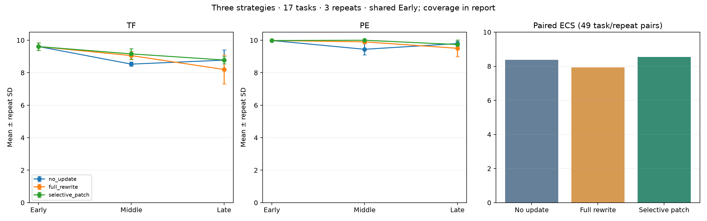
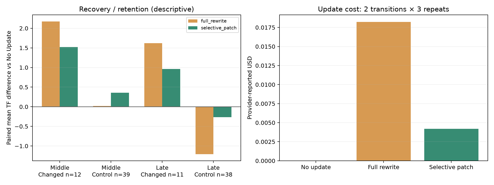

# Three-strategy evaluation / 三策略评估

Run: `20261026T084527.010290Z_Kevin`; protocol: `experience_evolution_v1`.

This report analyzes only the specified run, not earlier pilots. The older protocol document is not a reliable description of the evolved experience-memory implementation. / 仅分析指定运行，不混入旧试跑；实际清单及源码快照优先于旧协议描述。

## Coverage / 数据覆盖

| Measure | Value |
| --- | --- |
| logical_trajectories | 459 |
| logical_scored | 457 |
| physical_trajectories | 357 |
| physical_scored | 355 |
| shared_aliases | 102 |
| physical_statuses | {'completed': 355, 'execution_failed': 2} |
| judge_statuses | {'completed': 1737, 'failed': 38, 'not_attempted': 10} |
| paired_ecs_n | 49 |
| stage_matched_n | {'original': 51, 'iter3': 51, 'iter5': 49} |

Shared Early is executed/scored once per task/repeat and reused across strategies. Logical rows are not independent observations. Judge slots are scoring attempts, not experiment repeats. / Early共享，不能重复计算调用成本或样本数。

## Main results / 主结果

Within each stage use exactly the same valid task/repeat identities across all strategies. SD is across three repeat-level means (sample SD); denominators vary where execution failed. Paired ECS uses all-stage common identities and population SD within each triple. / 各版本三策略共同样本；均分波动按三次实验均分算，不把judge当重复。

| Strategy | Stage | Matched N | TF | TF repeat SD | PE | PE repeat SD | Paired ECS |
| --- | --- | --- | --- | --- | --- | --- | --- |
| no_update | original | 51 | 9.6118 | 0.2362 | 9.9843 | 0.0272 | 8.3708 |
| no_update | iter3 | 51 | 8.5304 | 0.1292 | 9.4441 | 0.3408 | 8.3708 |
| no_update | iter5 | 49 | 8.7755 | 0.6372 | 9.7963 | 0.1429 | 8.3708 |
| full_rewrite | original | 51 | 9.6118 | 0.2362 | 9.9843 | 0.0272 | 7.9391 |
| full_rewrite | iter3 | 51 | 9.0549 | 0.2513 | 9.9020 | 0.1028 | 7.9391 |
| full_rewrite | iter5 | 49 | 8.2020 | 0.8811 | 9.5048 | 0.5141 | 7.9391 |
| selective_patch | original | 51 | 9.6118 | 0.2362 | 9.9843 | 0.0272 | 8.5471 |
| selective_patch | iter3 | 51 | 9.1608 | 0.3201 | 10.0000 | 0.0000 | 8.5471 |
| selective_patch | iter5 | 49 | 8.7837 | 0.2239 | 9.7361 | 0.2775 | 8.5471 |

## Repeat-level ECS / 各重复的ECS

| Strategy | Repeat | Matched N | ECS |
| --- | --- | --- | --- |
| no_update | 0 | 15 | 8.6592 |
| no_update | 1 | 17 | 8.5459 |
| no_update | 2 | 17 | 7.9413 |
| full_rewrite | 0 | 15 | 8.2448 |
| full_rewrite | 1 | 17 | 8.2480 |
| full_rewrite | 2 | 17 | 7.3604 |
| selective_patch | 0 | 15 | 8.4081 |
| selective_patch | 1 | 17 | 8.4629 |
| selective_patch | 2 | 17 | 8.7541 |

| Strategy | Mean of 3 repeat ECS | Sample SD |
| --- | --- | --- |
| no_update | 8.3821 | 0.3860 |
| full_rewrite | 7.9511 | 0.5115 |
| selective_patch | 8.5417 | 0.1860 |

The mean of three repeat ECS values weights repeats equally; the primary pooled paired ECS weights the 49 valid task/repeat identities equally. They differ slightly because repeat 0 has 15 matched tasks and the others 17. / 重复均值与49配对样本均值权重不同，二者均明确报告。

## Recovery and retention / 恢复与保留

Absolute TF difference versus No Update on the same task/stage/repeat. These are descriptive paired effects, not proof of causation. The normalized recovery ratio is omitted because some Early baselines do not degrade and its cutoff was not established by this analysis. / 采用同任务同版本绝对差，不事后挑归一化公式。

| Strategy | Stage | Cohort | Matched N | Mean ΔTF | Negative pairs | Drops ≥2 (diagnostic) |
| --- | --- | --- | --- | --- | --- | --- |
| no_update | iter3 | changed | 12 | 0.0000 | 0 | 0 |
| no_update | iter3 | control | 39 | 0.0000 | 0 | 0 |
| no_update | iter5 | changed | 11 | 0.0000 | 0 | 0 |
| no_update | iter5 | control | 38 | 0.0000 | 0 | 0 |
| full_rewrite | iter3 | changed | 12 | 2.1708 | 0 | 0 |
| full_rewrite | iter3 | control | 39 | 0.0179 | 5 | 1 |
| full_rewrite | iter5 | changed | 11 | 1.6182 | 2 | 0 |
| full_rewrite | iter5 | control | 38 | -1.2079 | 12 | 6 |
| selective_patch | iter3 | changed | 12 | 1.5208 | 0 | 0 |
| selective_patch | iter3 | control | 39 | 0.3564 | 2 | 1 |
| selective_patch | iter5 | changed | 11 | 0.9636 | 2 | 1 |
| selective_patch | iter5 | control | 38 | -0.2684 | 8 | 2 |

## Update cost / 更新成本

Totals across six version transitions per strategy (two transitions × three repeats), not per task. Unlike the old catalog-only baseline, this run rewrites learned experience using a paid updater for Full Rewrite and Selective Patch. / 本次经验知识重写调用付费更新器，与旧版不同。

| Strategy | Updates | Calls | Input tokens | Output tokens | Seconds | Reported USD |
| --- | --- | --- | --- | --- | --- | --- |
| no_update | 6 | 0 | 0 | 0 | 0.0153 | 0 |
| full_rewrite | 6 | 42 | 132853 | 14955 | 229.4268 | 0.0182 |
| selective_patch | 6 | 12 | 30041 | 3944 | 76.2601 | 0.0042 |

Provider-reported update costs are used; reservation ceilings are not actual spend. Agent/judge tokens are recorded separately below; their USD is unavailable, not silently inferred as zero. Shared Early usage is charged once to its owner No Update; these totals are physical accounting rather than symmetric per-strategy runtime-cost estimates.

| Strategy | Role | Usage records | Input tokens | Output tokens |
| --- | --- | --- | --- | --- |
| no_update | agent | 350 | 4438622 | 86041 |
| no_update | judge | 765 | 7710550 | 121981 |
| full_rewrite | agent | 245 | 3253872 | 62600 |
| full_rewrite | judge | 505 | 5194120 | 80517 |
| selective_patch | agent | 233 | 3043918 | 53621 |
| selective_patch | judge | 505 | 5126080 | 81614 |

## Memory selection audit / 补丁范围审计

| Strategy | Entry transitions | Rebuilt | Unaffected entries rebuilt | Affected entries not rebuilt |
| --- | --- | --- | --- | --- |
| no_update | 42 | 0 | 0 | 12 |
| full_rewrite | 42 | 42 | 30 | 0 |
| selective_patch | 42 | 12 | 0 | 0 |

This audits dependency selection and retention of untouched records, not semantic or behavioral correctness of rebuilt text. No observed selection omission does not prove no possible under-update. / 选择范围正确不等于重写内容或实际行为必然正确。

## Limitations / 限制

- Only 17 gate-limited tasks (four changed, thirteen controls); not a representative estimate of all MCPEvol-Bench tasks. Change type and server family are confounded; pure Tool deletion cases are absent.
- Three repeats provide limited uncertainty evidence; no significance claim or post-hoc confidence threshold is made. Logical shared baselines are not treated as independent runs.
- Two execution failures are excluded under the recorded protocol. The valid-only estimates can be optimistic; report coverage and complete-case ECS together. Excluded records remain in analysis.json.
- dirty_source=true violates the older clean-commit protocol condition. The run contains a SHA-256-verified source.zip, frozen inputs and revision, so it is traceable; this is not equivalent to clean-source compliance.
- Judge validity is limited by the same Agent/judge model and partial judge slots; inspect trajectories instead of equating a high TF with independently verified task success.
- This experience-memory protocol must be explained to the report author. Do not reuse the old claim that Full Rewrite has zero update API cost.
- Causal under-update and over-update case evidence is reported separately in CASES.md; suspected cases must remain labeled suspected.

## Figures / 图表

